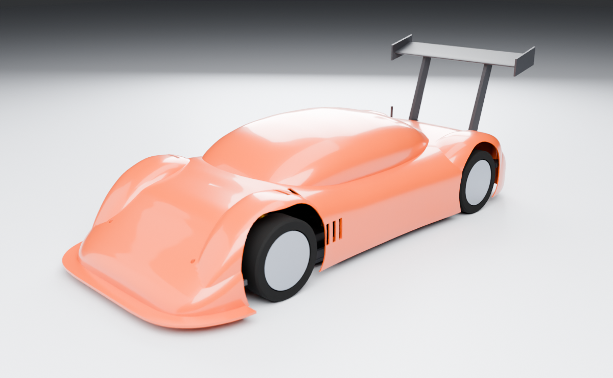

# RC Speed Platform (working name)

A 3D-printable 1/10 touring-size speed car: a printed chassis and an original printed GT body (GT-2), 4-wheel drive on two
belts, bought diffs, shocks, tyres and electronics.



One chassis, two power levels: **about 56 mph on 2S** or **about 82 mph on 3S** with the same motor and ESC [modelled].

> **Status: R&D prototype.** The numbers below come from the project's own models (speed, heat, CFD drag, strength,
> fit checks), not from a finished car on a track. Build it as an experiment, follow the safety guide, and read the
> [open items](#open-items) first.

## Tiers

| Tier | mph (mid) [modelled] | mph (high drag) | Real parts USD | All-in USD | USD per mph |
|---|---|---|---|---|---|
| 50 mph kit, no electronics | 55.6 | 55.4 | 175.01 | 433.13 | 7.79 |
| 50 mph complete | 55.6 | 55.4 | 344.36 | 612.98 | 11.02 |
| 80 mph kit, no electronics | 81.5 | 81.1 | 175.01 | 433.13 | 5.31 |
| 80 mph complete | 81.5 | 81.1 | 365.36 | 633.98 | 7.78 |

## Rebuild the parts

```bash
python3 -m venv .venv && .venv/bin/pip install -r requirements.txt
tools/rebuild.sh
```

## Build rules

- Every threaded point on a printed part is a captive **M3 hex nut** (DIN 934) in a slot: no heat-set inserts, no soldering for the car.
- **No glue**, except tyre CA on the tyre beads and one drop of thread-locker on the pinion grub screw.
- Prints on a 176 mm bed with a 0.4 or 0.6 mm nozzle in PETG-CF, PETG and TPU.

## Open items

- **Body lift:** the GT-2's lift comes from OpenFOAM, not a measurement. Do the leaf-blower and scales check in docs/06
  before running above 60 mph.
- **Belts:** the 3 mm belts are rated below a full-throttle launch. Keep the ESC punch low, or use the tech pack's launch
  current limit (docs/07).
- **Printed wheel hex and nut joints:** settle them with the coupon tests in docs/07 before running at speed.
- **Fans** need their own 5 V supply (not in the BOM yet).
- The ESP32 firmware has not been run on a board yet.

## License

Not chosen yet. Until a license file is added, all rights are reserved.
