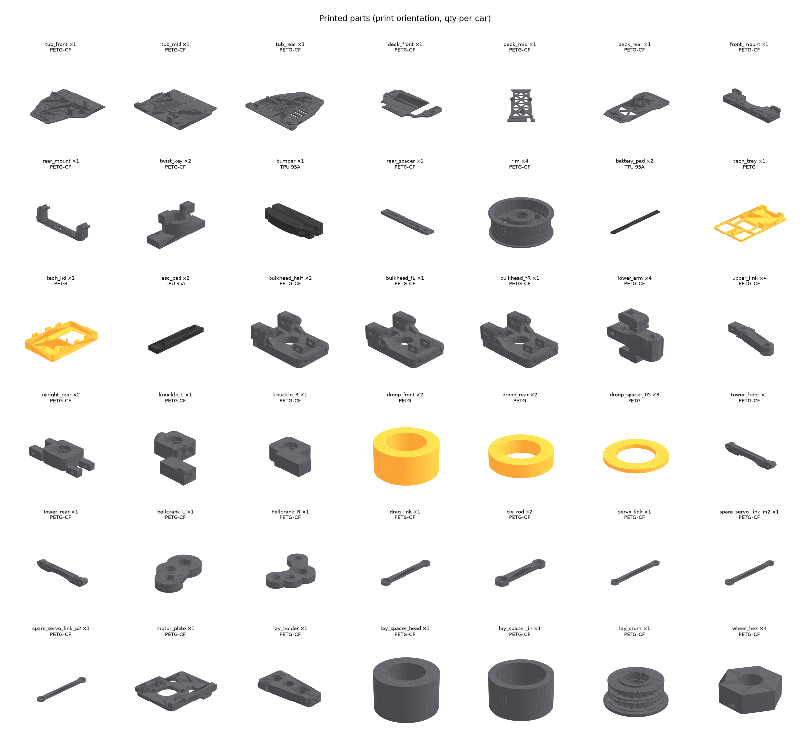

# 1. Printing

> Generated from the CAD and BOM data (counts are taken from the model, not typed). Numbers marked [estimate] are modelled or unverified; everything else is counted from the model or read from a seller's page.

Every printed part is one STL in `stl/`, already turned to its print orientation (flat face down, nut slots opening
sideways so they print without support). No slicer project files are shipped: slice them yourself with the settings
below. Every part fits a 176 × 176 mm bed.

## Printer and filament

- Any FDM printer with a 180 mm bed or bigger. The CAD is checked for a **0.4 mm or a 0.6 mm nozzle**; the 0.6 is faster and
  its walls are thicker (stronger). Keep the wall **count** in the table either way.
- **PETG-CF** (PETG with 5-15 % chopped carbon fibre) for every structural part, **PETG** for the small rings and tech
  tray, **TPU 95A** for the bumper and pads, **PLA** (or PLA-CF) for the gauges. Use a hardened-steel nozzle for CF.
- **Dry PETG and PETG-CF first** (4-6 h at 65 °C): wet PETG strings and is weaker across layers.
- Car parts, modelled volume: PETG 0 cm³, PETG-CF 408 cm³, TPU 95A 29 cm³; about 46.5<!--D:print_hours_car=46.5--> h of printing [estimate from volume].

## Print order

1. **Test prints first** (`C1`-`C4`): the nut ladder `C1_tolerance_ladder` tells you whether a DIN 934 M3 hex nut slides into the
   5.8 mm pocket and stays put when you tip the part over. If it will not go in, scale nothing: open `cad/anchors.py`,
   change `POCKET_S` by 0.1 mm and rebuild (`tools/rebuild.sh`). Do not file 65<!--D:nut_sites=65--> nut slots by hand.
2. `C2_insert_block` (nut pull test) and `C4` (hinge feel) next: see [7. Tuning](07_tuning.md#coupon-tests).
3. Then the car parts in any order; the floor (`tub_*`) takes longest.

## Settings per part

| File | Qty | Material | Layer mm | Walls / infill | Supports | Group | Orientation note |
|---|---|---|---|---|---|---|---|
| `tub_front.stl` | 1 | PETG-CF | 0.2 | 4 walls / 25% gyroid | none | car | floor down; countersinks face the bed; D34 isogrid pockets up |
| `tub_mid.stl` | 1 | PETG-CF | 0.2 | 4 walls / 25% gyroid | none | car | floor down |
| `tub_rear.stl` | 1 | PETG-CF | 0.2 | 4 walls / 25% gyroid | none | car | floor down |
| `deck_front.stl` | 1 | PETG-CF | 0.2 | 100% (3 mm plate) | none | car | D34: lap tongue under |
| `deck_mid.stl` | 1 | PETG-CF | 0.2 | 100% (3 mm plate) | none | car | D34: isogrid windows; prints on the diagonal |
| `deck_rear.stl` | 1 | PETG-CF | 0.2 | 100% (3 mm plate) | none | car | D34: runs over the rear bulkheads; rear tower bolts through it |
| `front_mount.stl` | 1 | PETG-CF | 0.16 | 5 walls / 60% | none | car | beam rear face down; lips point up |
| `rear_mount.stl` | 1 | PETG-CF | 0.16 | 5 walls / 60% | none | car | bar down, posts up |
| `twist_key.stl` | 2 | PETG-CF | 0.12 | 100% | none | car |  |
| `bumper.stl` | 1 | TPU 95A | 0.2 | 2 walls / 25% gyroid | none | car | crush block: the gyroid infill sets the crush force |
| `rear_spacer.stl` | 1 | PETG-CF | 0.2 | 4 walls / 100% | none | car | D53: flat as fitted (a 3 mm plate, its 4 floor-screw holes vertical): nothing overhangs; the 4 floor screws pass through it into the rear mount |
| `battery_pad.stl` | 2 | TPU 95A | 0.2 | 100% | none | car |  |
| `esc_pad.stl` | 2 | TPU 95A | 0.2 | 100% | none | car |  |
| `bulkhead_rL.stl` | 1 | PETG-CF | 0.16 | 5 walls / 40% | none | car | D57d rear LEFT saddle (mark L): cheek inner face down (bearing seat round) |
| `bulkhead_rR.stl` | 1 | PETG-CF | 0.16 | 5 walls / 40% | none | car | D57d rear RIGHT saddle (mark R): mirror of rL |
| `bulkhead_fL.stl` | 1 | PETG-CF | 0.16 | 5 walls / 40% | none | car | D46 front LEFT: diff seat offset for a whole-tooth front belt (mark L) |
| `bulkhead_fR.stl` | 1 | PETG-CF | 0.16 | 5 walls / 40% | none | car | D46 front RIGHT: mirror offset (mark R) |
| `bulkhead_cap_rL.stl` | 1 | PETG-CF | 0.16 | 5 walls / 40% | none | car | D57d rear LEFT bearing cap (mark L): inner face down; held by the 2 deck screws |
| `bulkhead_cap_rR.stl` | 1 | PETG-CF | 0.16 | 5 walls / 40% | none | car | D57d rear RIGHT bearing cap (mark R) |
| `bulkhead_cap_fL.stl` | 1 | PETG-CF | 0.16 | 5 walls / 40% | none | car | D57 front LEFT bearing cap (mark L) |
| `bulkhead_cap_fR.stl` | 1 | PETG-CF | 0.16 | 5 walls / 40% | none | car | D57 front RIGHT bearing cap (mark R) |
| `lay_cap_plate.stl` | 1 | PETG-CF | 0.16 | 5 walls / 50% | none | car | D57 motor-plate layshaft cap; captive nut for the deck-lap screw |
| `lay_cap_holder.stl` | 1 | PETG-CF | 0.16 | 5 walls / 50% | none | car | D57 lay-holder cap; upper half of the nyloc trap |
| `lower_arm.stl` | 4 | PETG-CF | 0.16 | 5 walls / 50% | none | car | on its side: pin holes vertical; same part at all 4 corners |
| `upper_link.stl` | 4 | PETG-CF | 0.16 | 100% | none | car | on its side; same part at all 4 corners |
| `upright_rear.stl` | 2 | PETG-CF | 0.16 | 5 walls / 50% | none | car | bearing axis vertical |
| `knuckle_L.stl` | 1 | PETG-CF | 0.16 | 5 walls / 50% | tree, under the steering arm | car | front left |
| `knuckle_R.stl` | 1 | PETG-CF | 0.16 | 5 walls / 50% | tree, under the steering arm | car | front right (mirror) |
| `droop_front.stl` | 2 | PETG | 0.12 | 100% | none | car | D33: front droop stack, one ring on each bought front shock's shaft (0.3 mm wheel droop) |
| `droop_rear.stl` | 2 | PETG | 0.12 | 100% | none | car | D33: rear droop stack, one ring on each bought rear shock's shaft (3 mm wheel droop) |
| `droop_spacer_05.stl` | 8 | PETG | 0.12 | 100% | none | car | D30: 0.5 mm droop shim, add/remove to tune |
| `tower_front.stl` | 1 | PETG-CF | 0.2 | 4 walls / 40% | none | car |  |
| `tower_rear.stl` | 1 | PETG-CF | 0.2 | 4 walls / 40% | none | car |  |
| `bellcrank_L.stl` | 1 | PETG-CF | 0.16 | 100% | none | car |  |
| `bellcrank_R.stl` | 1 | PETG-CF | 0.16 | 100% | none | car | has the servo arm |
| `drag_link.stl` | 1 | PETG-CF | 0.16 | 100% | none | car | M3 ball-stud cups |
| `tie_rod.stl` | 2 | PETG-CF | 0.16 | 100% | none | car | M3 ball-stud cups |
| `servo_link.stl` | 1 | PETG-CF | 0.16 | 100% | none | car | length [unverified] until the servo horn is fitted; the 2 spare_servo_link parts are 2 mm shorter / longer |
| `spare_servo_link_m2.stl` | 1 | PETG-CF | 0.16 | 100% | none | car | D53 QA: servo_link 2 mm shorter (the horn tip is [unverified]); keep the one that gives equal lock, not on the car's mass |
| `spare_servo_link_p2.stl` | 1 | PETG-CF | 0.16 | 100% | none | car | D53 QA: servo_link 2 mm longer (the horn tip is [unverified]); keep the one that gives equal lock, not on the car's mass |
| `motor_plate.stl` | 1 | PETG-CF | 0.16 | 5 walls / 50% | tree, under the plate (bosses on the bed side) | car | touches the motor only on 2 standoff bosses |
| `lay_holder.stl` | 1 | PETG-CF | 0.16 | 5 walls / 50% | none | car | nut trap up; clamps the fixed layshaft axle (D50); D57: lower half |
| `lay_spacer_head.stl` | 1 | PETG-CF | 0.16 | 100% | none | car | ring between the axle screw head and the motor plate (D50) |
| `lay_spacer_in.stl` | 1 | PETG-CF | 0.12 | 100% | none | car | thin ring on the axle inside the spur (D50) |
| `lay_drum.stl` | 1 | PETG-CF | 0.12 | 100% | none | car | spur flange down; wear part |
| `wheel_hex.stl` | 4 | PETG-CF | 0.12 | 100% | none | car | wear part |
| `rim.stl` | 4 | PETG-CF | 0.12 | 5 walls / 25% | organic (D53 sliced: 5.0 g under the 52 mm face-web bridges) | spare / plain rim | D45: inboard face down; bought Tamiya 54994 belted tyre CA-glued to both bead seats; balance <= 0.5 g |
| `tech_tray.stl` | 1 | PETG | 0.2 | 3 walls / 100% (3 mm plate) | none | tech pack | D51: flat, pockets up; 3 M3 screws into the deck bosses' captive hex nuts on washers (D55) |
| `tech_lid.stl` | 1 | PETG | 0.2 | 2 walls / 100% (1 mm skin) | none | tech pack | D51: top on the bed, walls up; snaps over the tray edges |
| `C1_tolerance_ladder.stl` | 1 | PETG-CF | 0.16 | 100% | none | test print | coupon: see rnd/stage3/coupons.md |
| `C2_insert_block.stl` | 1 | PETG-CF | 0.16 | 100% | none | test print | coupon: see rnd/stage3/coupons.md |
| `C4_hinge_lug.stl` | 1 | PETG-CF | 0.16 | 100% | none | test print | coupon: see rnd/stage3/coupons.md |
| `C4_hinge_arm.stl` | 1 | PETG-CF | 0.16 | 100% | none | test print | coupon: see rnd/stage3/coupons.md |
| `G1_bearing_ladder.stl` | 1 | PLA-CF | 0.16 | 100% | none | test print | coupon: see rnd/stage3/coupons.md |
| `G2_diff_span_gauge.stl` | 1 | PLA-CF | 0.16 | 100% | none | test print | coupon: see rnd/stage3/coupons.md |
| `G3_motor_face_gauge.stl` | 1 | PLA-CF | 0.16 | 100% | none | test print | coupon: see rnd/stage3/coupons.md |
| `G4_axle_pin_gauge.stl` | 1 | PLA-CF | 0.16 | 100% | none | test print | coupon: see rnd/stage3/coupons.md |
| `C3_tread_rim_segment.stl` | 1 | PETG-CF | 0.16 | 100% | none | test print | coupon: see rnd/stage3/coupons.md |
| `C3_tread_segment.stl` | 1 | TPU 95A | 0.16 | 100% | none | test print | coupon: see rnd/stage3/coupons.md |

**Common settings:** PETG-CF 250-260 °C, bed 80 °C, part fan 30-50 %; PETG 235-245 °C; TPU 220-230 °C, slow (20-25 mm/s),
no retraction tuning needed for these simple shapes. Brim only where the slicer warns about a small footprint.

## Body (GT-2)

The body is 9<!--D:gt2_parts=9--> prints in `stl/body_gt2/`: six skin panels (front, middle, rear, left and right), two carrier
plates and the wing. The panels are a **1.2<!--D:gt2_wall=1.2--> mm skin**: 2 lines on a 0.6 mm nozzle or 3 on a 0.4. Print them with the
paint side up and tree supports touching the inside only; every panel and the wing fit the 176 mm bed as turned in the file.
About 341.5<!--D:gt2_g=341.5--> g of filament [estimate from volume].

| File | Material | Walls / infill | Supports | Size mm (as printed) | g [estimate] |
|---|---|---|---|---|---|
| `body_gt2/gt2_body_front_L.stl` | PETG | solid skin (2 lines at 0.6 mm) | tree, inside only (paint side clean) | 168 × 104 × 92 | 39.0 |
| `body_gt2/gt2_body_front_R.stl` | PETG | solid skin (2 lines at 0.6 mm) | tree, inside only (paint side clean) | 168 × 111 × 92 | 42.6 |
| `body_gt2/gt2_body_mid_L.stl` | PETG | solid skin (2 lines at 0.6 mm) | tree, inside only (paint side clean) | 139 × 90 × 100 | 41.5 |
| `body_gt2/gt2_body_mid_R.stl` | PETG | solid skin (2 lines at 0.6 mm) | tree, inside only (paint side clean) | 139 × 97 × 100 | 43.6 |
| `body_gt2/gt2_body_rear_L.stl` | PETG | solid skin (2 lines at 0.6 mm) | tree, inside only (paint side clean) | 149 × 93 × 92 | 49.8 |
| `body_gt2/gt2_body_rear_R.stl` | PETG | solid skin (2 lines at 0.6 mm) | tree, inside only (paint side clean) | 149 × 100 × 92 | 53.8 |
| `body_gt2/gt2_carrier_front.stl` | PETG-CF | 100% infill | none | 138 × 138 × 4 | 31.8 |
| `body_gt2/gt2_carrier_rear.stl` | PETG-CF | 4 walls / 40% | none | 140 × 140 × 4 | 16.2 |
| `body_gt2/gt2_wing.stl` | PETG-CF | 4 walls / 40% | tree: under the plane and end plates (pegs up) | 52 × 162 × 104 | 23.2 |

## Parts check after printing

| ✓ | Item | Qty | Check |
|---|---|---|---|
| ☐ | `tub_front` | 1 | nut slots clear, screw holes round, no stringing in the hex pockets |
| ☐ | `tub_mid` | 1 | nut slots clear, screw holes round, no stringing in the hex pockets |
| ☐ | `tub_rear` | 1 | nut slots clear, screw holes round, no stringing in the hex pockets |
| ☐ | `deck_front` | 1 | nut slots clear, screw holes round, no stringing in the hex pockets |
| ☐ | `deck_mid` | 1 | nut slots clear, screw holes round, no stringing in the hex pockets |
| ☐ | `deck_rear` | 1 | nut slots clear, screw holes round, no stringing in the hex pockets |
| ☐ | `front_mount` | 1 | nut slots clear, screw holes round, no stringing in the hex pockets |
| ☐ | `rear_mount` | 1 | nut slots clear, screw holes round, no stringing in the hex pockets |
| ☐ | `twist_key` | 2 | nut slots clear, screw holes round, no stringing in the hex pockets |
| ☐ | `bumper` | 1 | nut slots clear, screw holes round, no stringing in the hex pockets |
| ☐ | `rear_spacer` | 1 | nut slots clear, screw holes round, no stringing in the hex pockets |
| ☐ | `battery_pad` | 2 | nut slots clear, screw holes round, no stringing in the hex pockets |
| ☐ | `esc_pad` | 2 | nut slots clear, screw holes round, no stringing in the hex pockets |
| ☐ | `bulkhead_rL` | 1 | nut slots clear, screw holes round, no stringing in the hex pockets |
| ☐ | `bulkhead_rR` | 1 | nut slots clear, screw holes round, no stringing in the hex pockets |
| ☐ | `bulkhead_fL` | 1 | nut slots clear, screw holes round, no stringing in the hex pockets |
| ☐ | `bulkhead_fR` | 1 | nut slots clear, screw holes round, no stringing in the hex pockets |
| ☐ | `bulkhead_cap_rL` | 1 | nut slots clear, screw holes round, no stringing in the hex pockets |
| ☐ | `bulkhead_cap_rR` | 1 | nut slots clear, screw holes round, no stringing in the hex pockets |
| ☐ | `bulkhead_cap_fL` | 1 | nut slots clear, screw holes round, no stringing in the hex pockets |
| ☐ | `bulkhead_cap_fR` | 1 | nut slots clear, screw holes round, no stringing in the hex pockets |
| ☐ | `lay_cap_plate` | 1 | nut slots clear, screw holes round, no stringing in the hex pockets |
| ☐ | `lay_cap_holder` | 1 | nut slots clear, screw holes round, no stringing in the hex pockets |
| ☐ | `lower_arm` | 4 | nut slots clear, screw holes round, no stringing in the hex pockets |
| ☐ | `upper_link` | 4 | nut slots clear, screw holes round, no stringing in the hex pockets |
| ☐ | `upright_rear` | 2 | nut slots clear, screw holes round, no stringing in the hex pockets |
| ☐ | `knuckle_L` | 1 | nut slots clear, screw holes round, no stringing in the hex pockets |
| ☐ | `knuckle_R` | 1 | nut slots clear, screw holes round, no stringing in the hex pockets |
| ☐ | `droop_front` | 2 | nut slots clear, screw holes round, no stringing in the hex pockets |
| ☐ | `droop_rear` | 2 | nut slots clear, screw holes round, no stringing in the hex pockets |
| ☐ | `droop_spacer_05` | 8 | nut slots clear, screw holes round, no stringing in the hex pockets |
| ☐ | `tower_front` | 1 | nut slots clear, screw holes round, no stringing in the hex pockets |
| ☐ | `tower_rear` | 1 | nut slots clear, screw holes round, no stringing in the hex pockets |
| ☐ | `bellcrank_L` | 1 | nut slots clear, screw holes round, no stringing in the hex pockets |
| ☐ | `bellcrank_R` | 1 | nut slots clear, screw holes round, no stringing in the hex pockets |
| ☐ | `drag_link` | 1 | nut slots clear, screw holes round, no stringing in the hex pockets |
| ☐ | `tie_rod` | 2 | nut slots clear, screw holes round, no stringing in the hex pockets |
| ☐ | `servo_link` | 1 | nut slots clear, screw holes round, no stringing in the hex pockets |
| ☐ | `spare_servo_link_m2` | 1 | nut slots clear, screw holes round, no stringing in the hex pockets |
| ☐ | `spare_servo_link_p2` | 1 | nut slots clear, screw holes round, no stringing in the hex pockets |
| ☐ | `motor_plate` | 1 | nut slots clear, screw holes round, no stringing in the hex pockets |
| ☐ | `lay_holder` | 1 | nut slots clear, screw holes round, no stringing in the hex pockets |
| ☐ | `lay_spacer_head` | 1 | nut slots clear, screw holes round, no stringing in the hex pockets |
| ☐ | `lay_spacer_in` | 1 | nut slots clear, screw holes round, no stringing in the hex pockets |
| ☐ | `lay_drum` | 1 | nut slots clear, screw holes round, no stringing in the hex pockets |
| ☐ | `wheel_hex` | 4 | nut slots clear, screw holes round, no stringing in the hex pockets |

