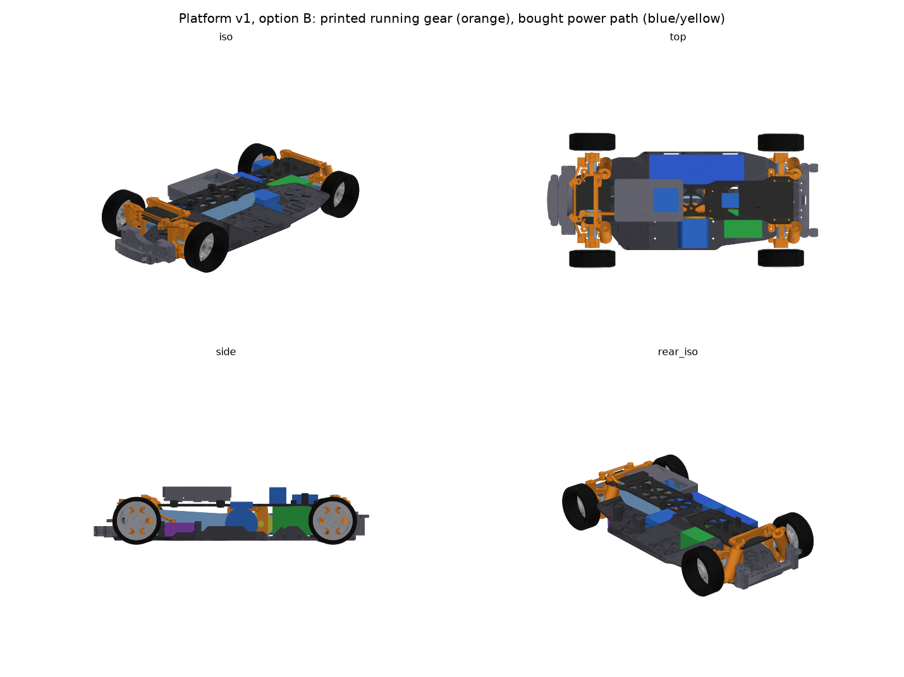
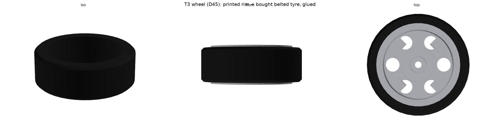
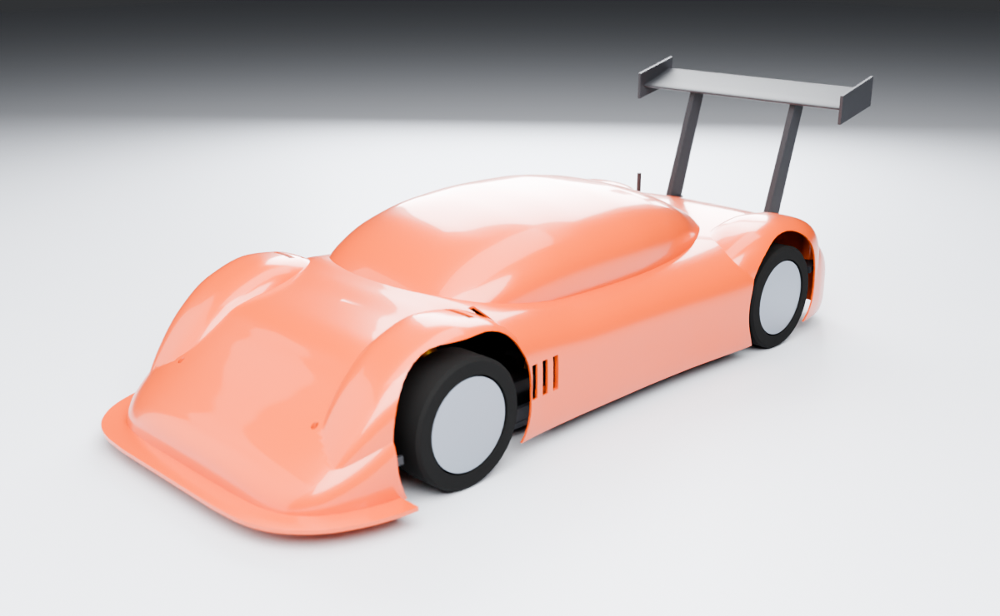

# 3. Assembly

> Generated from the CAD and BOM data (counts are taken from the model, not typed). Numbers marked [estimate] are modelled or unverified; everything else is counted from the model or read from a seller's page.

The same steps build every tier. Where the tiers differ (battery, pinion, electronics) the step says so.

## Tools

Hex drivers 1.5, 2.0 and 2.5 mm (a ball-end 2.5 mm helps), 3 mm hex key (layshaft shoulder screw), 5.5 mm and 7 mm nut
drivers, side cutters, tweezers, a pin vise with a 2.5 mm drill. **No soldering iron** for the car itself (only the
optional tech pack). **No heat-set inserts**: every threaded point is a captive M3 hex nut.

## Rules that hold everywhere

- **No glue and no tape**, except tyre CA on the tyre-to-rim beads and one drop of thread-locker on the pinion grub screw.
- No thread-locker on any screw into plastic: it attacks PETG.
- Tighten screws into plastic until snug, then stop: the plastic is the limit, not the screw.

## Hardware (counted from the CAD)

65<!--D:nut_count=65--> M3 hex nuts (DIN 934, 5.5 mm AF × 2.4 mm), 45<!--D:washer_count=45--> of them on an M3 washer (DIN 125, 7 × 0.5 mm) under the nut.
Buy one 100-pack of each.

| Screw | Count |
|---|---|
| M3 x 10 flat-head (ISO 10642, countersunk in the floor) | 4 |
| M3 x 10 socket cap | 13 |
| M3 x 12 flat-head (ISO 10642, countersunk in the floor) | 10 |
| M3 x 12 socket cap (tower feet: deck 3 + foot 3 mm) | 4 |
| M3 x 14 flat-head (ISO 10642, countersunk in the floor) | 6 |
| M3 x 14 socket cap | 2 |
| M3 x 16 flat-head (ISO 10642, countersunk in the floor) | 8 |
| M3 x 25 socket cap | 2 |
| M3 x 6 flat-head (ISO 10642), tub laps, up into a hex nut on top | 16 |
| M3 x 30 socket cap + M3 nyloc: lower-arm hinges | 4 |
| M3 x 16 socket cap: upper-link pins | 4 |
| M3 x 25 socket cap: shock top eyes | 4 |
| M3 x 12 socket cap: shock bottom eyes [length unverified] | 4 |
| M3 x 8 socket cap: motor to plate, on fibre washers [length unverified] | 2 |
| M3 x 8 self-tapping button head: spur to drum [spur hole pattern unverified] | 3 |

## How every captive nut goes in

Each nut slides into a slot from the side of the part **before** the part is fitted. Where the table says "on a washer",
slide the washer in first (it goes on the screw-head side of the nut), then the nut. Push with tweezers until you can look
down the screw hole and see the nut's thread centred. The hex slot has two flats along it, so the nut cannot turn. If a
slot faces down when the part is in place, thread a screw two turns into the nut first, fit the part, then swap in the
real screw. 36<!--D:pad_sites=36--> sites sit in small grown pads of plastic (they look like a bump on the part): they are
normal nut slots.

## 1. Floor

1. Lay `tub_front`, `tub_mid` and `tub_rear` together at the two laps. Drop a hex nut into each of the 16<!--D:lap_nuts=16--> hex
   recesses on top of the laps and drive an M3 × 6 flat-head up through each from the underside.
2. Nuts in the tub: `tub_front` 2 hex nuts: 2 × M3 x 10 socket cap; `tub_mid` 2 hex nuts: 2 × M3 x 10 socket cap.
3. Press the TPU `battery_pad` (2) and `esc_pad` (2) over the floor pegs.
4. `front_mount` (8 hex nuts (8 on a washer): 2 × M3 x 25 socket cap, 2 × M3 x 10 socket cap, 2 × M3 x 12 flat-head (ISO 10642, countersunk in the floor), 2 × M3 x 14 flat-head (ISO 10642, countersunk in the floor)): screw it to the floor from below, then the TPU `bumper` to its face.
5. `rear_spacer` on the floor tail, `rear_mount` on top (6 hex nuts (6 on a washer): 2 × M3 x 14 socket cap, 4 × M3 x 14 flat-head (ISO 10642, countersunk in the floor)); 4 floor screws up through all three.

## 2. Bulkheads and diffs

`bulkhead_half` (12 hex nuts in each of the 2 pieces (12 on a washer): 4 × M3 x 12 flat-head (ISO 10642, countersunk in the floor), 4 × M3 x 16 flat-head (ISO 10642, countersunk in the floor), 4 × M3 x 10 socket cap), `bulkhead_fL` (6 hex nuts (6 on a washer): 2 × M3 x 12 flat-head (ISO 10642, countersunk in the floor), 2 × M3 x 16 flat-head (ISO 10642, countersunk in the floor), 2 × M3 x 10 socket cap), `bulkhead_fR` (6 hex nuts (6 on a washer): 2 × M3 x 12 flat-head (ISO 10642, countersunk in the floor), 2 × M3 x 16 flat-head (ISO 10642, countersunk in the floor), 2 × M3 x 10 socket cap).
`fL` goes on the left, `fR` on the right. Press a 6700 bearing into each seat by thumb, drop the diff between two halves,
check it spins, then screw the halves to the floor from below.

## 3. Layshaft, motor and belts

`motor_plate` (4 hex nuts (4 on a washer): 2 × M3 x 10 flat-head (ISO 10642, countersunk in the floor), 2 × M3 x 10 socket cap); `lay_holder` (3 hex nuts (3 on a washer): 2 × M3 x 10 flat-head (ISO 10642, countersunk in the floor), 1 × M3 x 10 socket cap).

1. Press an MR105 bearing into each end of `lay_drum`.
2. On the 5 mm shoulder screw (the fixed axle), in order: `lay_spacer_head`, `motor_plate`, `lay_spacer_in`, `lay_drum`
   (spur flange toward the motor), an M4 washer. Through `lay_holder`, M4 nyloc into its hex pocket; snug, the drum must spin
   with a trace of end-play.
3. Spur (66T) to the drum flange with 3 self-tappers (drill 2.5 mm pilots through the drum's holes if the spur's own
   pattern does not line up).
4. Motor to the plate with 2 M3 screws on fibre washers (2 between motor face and plate, 2 under each head): no plastic
   touches the hot can.
5. **Pinion:** 33T for both tiers (the motor plate's slots take 30-38T: slide the motor until the
   gears mesh with a strip of paper between them, then tighten). One drop of thread-locker on the grub screw.
6. Belts: front 141T (S3M 423 mm), rear 93T (S3M 279 mm), 3 mm wide. About 3 mm of deflection under a fingertip.
7. Motor plate and lay holder: 2 floor screws each from below; their deck screws go in with the deck.

## 4. Suspension and steering

Run each M3 hinge bolt through its printed hole once with the driver so the part swings freely.

1. `lower_arm` (4) between the bulkhead lugs, M3 × 30 + nyloc each, free swing, no rattle.
2. `upper_link` (4) into the bulkhead fork, M3 × 16.
3. Rear `upright_rear` (2): bearings in by thumb, pin to arm and link. Front `knuckle_L` / `knuckle_R`: ball studs top and bottom.
4. CVDs into the outdrives and the hub bearings; fit one first and swing the arm through its travel; if it binds, stop.
   `wheel_hex` on its drive pin, then the M4 flange nyloc.
5. Shocks: fit the 6.48 N/mm springs (Century Spring 71891), the printed droop ring (`droop_front` / `droop_rear`, shim with
   `droop_spacer_05`), lower eye to the arm, upper eye M3 × 25 through `tower_front` / `tower_rear` with one 2.0 mm alu shim.
6. Steering: `bellcrank_L` / `bellcrank_R` on their deck posts, `drag_link` between them, a `tie_rod` to each knuckle.
7. Servo on its posts; centre it, then pick the `servo_link` (or the ±2 mm spares) that gives equal lock both ways, no bind.

## 5. Deck and electronics

1. Heat sink on the motor can, fans up, before the deck. **Fans need their own 5 V supply** (the receiver rail cannot
   carry them with the servo). Until they have one, keep to bench tests.
2. `deck_front`, `deck_mid`, `deck_rear` on; deck screws into the bulkheads, motor plate, lay holder; tower feet M3 × 12.
3. ESC on its TPU pads. Battery bay lined with the cut LiPo bag. Battery in with its 2 straps.
   - **50 mph:** 2S pack (130 × 42 × 18 mm, XT60): use the XT60-to-T-plug lead or fit a T-plug to match the ESC.
   - **80 mph:** 3S pack (132 × 43 × 25 mm listed, T-plug).
4. Receiver into the deck cradle until both hooks click. Radio fail-safe set to neutral throttle; test it wheels-up.
5. ESC: LiPo cut-off set for the pack's cell count (2S or 3S) before the first run.

## 6. Wheels and tyres

1. Push a 40° foam insert into each belted tyre and seat it on a printed `rim` (beads between the 2 mm flanges). Dry-fit one
   tyre first: the tyre maker publishes no bead diameter.
2. Wipe the bead seats with isopropyl alcohol (do not sand), then a thin line of tyre CA round both beads: the one place
   glue is allowed.
3. Balance each wheel on its axle held level: the heavy side stops at the bottom. No tape or putty.
4. `wheel_hex` on the axle's drive pin, wheel on, M4 flange nyloc. The hex stands 2.5 mm proud of the hub face: that is right.

## 7. Body (GT-2)

The GT-2 body is six skin panels, two carrier plates and the wing, held by hidden M3 screws into captive hex nuts. Nothing is
glued. You need 34<!--D:gt2_m12_a=34--> M3 × 12 socket-cap screws, 2 M3 × 10 and 36<!--D:gt2_nuts_a=36--> DIN 934 M3 hex nuts.

1. **Nuts first.** Push a hex nut into every nut slot: 26<!--D:gt2_stations=26--> seam stations (the block on the nut side of
   each seam), 8<!--D:gt2_cols=8--> carrier columns (slots face the car's centre line) and one in each wing peg. A nut that falls out
   means the slot prints loose: see the nut ladder in [1. Printing](01_printing.md#print-order).
2. **Left to right.** Lay each left panel on its right partner so the flange laps under the joint, and drive the
   centre-seam screws (3 front, 3 middle,
   4 rear) from the head blocks into the nuts. Snug only: the skin is 1.2 mm.
3. **Front to back.** Join front to middle and middle to rear the same way, 4 screws per side
   at each seam. The panel behind owns the flange.
4. **Carriers.** Press the 10 × 3 mm magnets into the carrier pockets (crush ribs hold them). Hold `gt2_carrier_front` under the
   nose columns and drive 4 M3 × 12 up from below; `gt2_carrier_rear` takes 4.
5. **Wing.** Drop the two leg pegs into the deck sockets and drive one M3 × 10 up through each 8 mm access hole in the rear
   carrier into the peg's nut. The wing is a crash part: a hard side knock snaps the legs, not the shell.
6. **On the car.** Front tongue under the hook lips, rear plate on the two posts, then turn both twist keys a quarter turn.
7. **Radio aerials stay inside the shell.** Lay the receiver's two 2.4 GHz aerials along the deck, tips apart and away from
   the motor wires. The plastic body does not block 2.4 GHz; do not run an aerial tube through it.

The speed and lift numbers in [2. Sourcing](02_sourcing.md) are for this body. **Do not run above bench speed without it.**

## Bring your own electronics

For the kit tiers, the car is drawn around these sizes and limits. Anything else is untested.

| Item | What fits / what it must do |
|---|---|
| Motor | 3650 size: the CAD envelope is 36 mm can × 50 mm, 3.175 mm shaft, 2 × M3 face screws on 25 mm [spacing unverified: print gauge G3]; 3900 KV for these speeds |
| ESC | ≥ 60 A continuous, 2-3S LiPo, adjustable punch and LiPo cut-off; must fit 52 × 39 × 39 mm |
| Servo | standard size, must fit 40.5 × 20 × 40 mm; ≥ 15 kg·cm, metal gears [estimate: the designed-on DS3218 is 20 kg·cm] |
| Radio | 2.4 GHz, 3+ channels, **fail-safe to neutral throttle** (test it); receiver must fit 35 × 20 × 13 mm (the cradle) |
| Battery | 50 mph: 2S; 80 mph: 3S; must fit 132.0 × 43.2 × 29.5 mm |
| Charger | LiPo balance charger with storage mode |

## Parts check before the first run

| ✓ | Item | Qty | Check |
|---|---|---|---|
| ☐ | every captive nut | 65<!--D:nut_count2=65--> | a screw in each turns smoothly; no nut spinning |
| ☐ | diffs | 2 | turn the wheels by hand: no click, no bind |
| ☐ | belts | 2 | ~3 mm deflection, aligned on both pulleys |
| ☐ | pinion mesh | 1 | a paper strip's backlash; grub screw on the flat |
| ☐ | steering | 1 | equal lock both ways, no bind |
| ☐ | fail-safe | 1 | transmitter off: motor stops (wheels up) |
| ☐ | battery straps | 2 | pack cannot slide |
